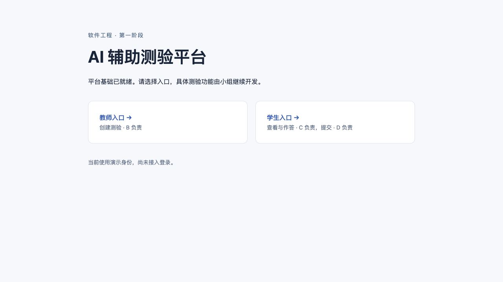
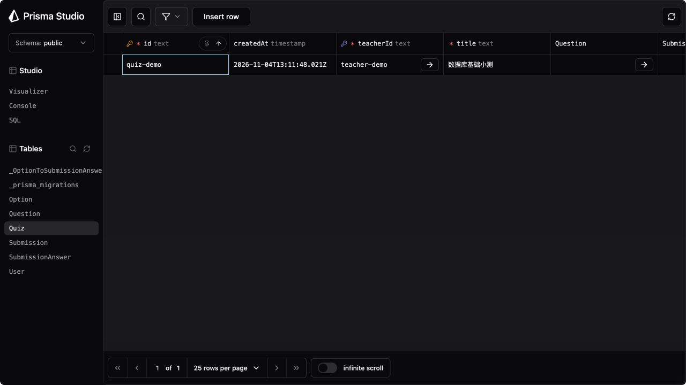

# A 阶段交付与真实验证报告

验证日期：2026-11-04（America/New_York）。

## 交付结果

- 已完成 npm workspaces（client/server/shared）、入口页、数据库 schema / migration / 固定 seed、共享 Zod 契约与全部响应类型、演示身份、Prisma 单例、统一错误、apiFetch、空业务路由、README 与接口文档。
- 云端仓库：<https://github.com/Ra1ncn/soft_eng>；工作分支：`chore/phase1-foundation`。main 只有 `.gitignore` 初始化提交，功能通过 PR review 后再合并。
- 四个业务接口仍未实现，真实请求目前返回统一 404。这是 A 的范围边界；老师创建 → 学生作答 → 提交保存整条业务流程要等 B/C/D 完成后联调。
- 无部署、登录、session、评分、截止时间、发布状态、访问码、AI 或 CI。

## 全新 clone 验证

从 GitHub 新克隆分支到独立目录 `quiz-platform-acceptance/`，没有复用开发目录的 node_modules、生成客户端或数据库卷。首次验收代码提交为 `67fcd07`；随后拉取 `f82106b`，仅删除两个占位页中的 API 调用提示文字，补跑类型检查并在浏览器验证页面。后续交付报告及截图为文档变动。

环境先配置 Node 的 PATH 和可用 Docker context；以下命令都在验收 clone 的根目录执行。首次建库使用全新的 `quiz-platform-acceptance_postgres_data` 卷，PostgreSQL 18.1。

| 验证命令 / 操作 | 实际结果 |
| --- | --- |
| `git clone --branch chore/phase1-foundation https://github.com/Ra1ncn/soft_eng.git quiz-platform-acceptance` | 成功，从远程独立 clone |
| `npm ci` | 成功，安装 332 个依赖包，审计 0 个已知漏洞 |
| `cp .env.example .env` | 成功，仅使用本机演示值 |
| `docker compose up -d` | 成功，创建新容器、网络和独立数据库卷 |
| `docker compose up -d --wait` | 成功，数据库 healthy |
| `npx prisma migrate dev` | 成功，应用 `20261104035957_init`，无 schema drift |
| `npx prisma db seed`（第 1 次） | 成功，实际查到 2 User / 1 Quiz / 2 Question / 5 Option |
| `npx prisma db seed`（连续第 2 次） | 成功，行数完全一致，无重复；Submission 和 SubmissionAnswer 都为 0 |
| `docker compose exec -T db psql -U quiz -d quiz -c 'SELECT id, title FROM "Quiz";'` | 查到 `quiz-demo`，标题为“数据库基础小测” |
| `npm run typecheck` | client、server、shared 全部通过；占位页文字变动后也重跑通过 |
| `npm test` | 4 个测试文件、37 项测试全部通过 |
| `npm run build` | 成功，生成前端产物；React Router 的 `use client` 指令出现非阻塞打包警告 |
| `npm run dev` | 同时启动 Vite（5173）和 Express（3001），两者日志正常 |
| `curl http://localhost:3001/api/health` | 200：`{"status":"ok","database":"ok","demoQuizFound":true}` |
| `curl http://localhost:5173/api/health` | 200，内容相同，证明 Vite 代理工作 |
| 浏览器访问 `/` 并点击教师入口；访问 `/student` | 三个页面实际渲染，显示对应入口占位说明；直接请求三个 URL 也均为 200 |
| `npx prisma studio --port 5555 --browser none` | Studio 实际启动；浏览器打开 Quiz 表，显示 `quiz-demo` 和 `teacher-demo` |
| `git ls-files .env` | 无输出，`.env` 未跟踪 |
| `git check-ignore .env` | 输出 `.env`，忽略规则生效 |
| 人工逐条对照 `docs/api.md` 与 `shared/contracts.ts` | 四个请求/响应、角色、空 answers、正确选项数量、重复项、字段路径、UTC 日期、错误格式一致；依赖数据库的归属与单选作答规则已明确留给 D |

数据库幂等性检查实际执行 SQL：

```sql
SELECT 'User' AS model, count(*) FROM "User"
UNION ALL SELECT 'Quiz', count(*) FROM "Quiz"
UNION ALL SELECT 'Question', count(*) FROM "Question"
UNION ALL SELECT 'Option', count(*) FROM "Option"
UNION ALL SELECT 'Submission', count(*) FROM "Submission"
UNION ALL SELECT 'SubmissionAnswer', count(*) FROM "SubmissionAnswer";
```

另做数据库故障实测：`docker compose stop db` 后请求 `/api/health`，实际返回 500 `{"error":{"code":"INTERNAL_ERROR","message":"服务器内部错误"}}`，未泄漏连接细节。随后 `docker compose up -d --wait` 恢复，再请求返回 200 且 `demoQuizFound: true`。

Vitest 包含合法/非法创建、单选 0/1/2 个正确选项、多选至少一个正确选项、空作答、重复题目/选项（含 trim 后重复）、合法/缺失/非法身份、缺失 seed 用户、500 隐藏内部信息、非法 JSON、统一 404、业务路由保持空、apiFetch 请求头及错误传播。身份单元测试使用数据库 mock；seed、健康检查和 Studio 则连接真实 PostgreSQL。





## 验证过程中修正的问题

1. 第一次远程 clone 发现 compose.yaml 漏入提交，数据库启动失败。已补交并重新使用干净 clone 验证。
2. Prisma 7 的 `migrate dev` 不再自动生成 Client，首次 seed 出现模块缺失。不能依赖开发目录中已有的生成文件。
3. 直接在 Prisma seed 配置拼接 `&&` 的试验未执行实际 seed，尽管 CLI 退出码为 0，查询行数全为 0。最终配置改为 `seed: "npm run db:seed"`，由 npm 的 shell 脚本执行 `prisma generate && tsx server/prisma/seed.ts`；再从全新 clone 和全新数据库卷完整验收，实际行数符合预期。

早期失败和零行数试验没有计入通过结果。最终 raw logs 保存在本机 `quiz-platform-backups/acceptance-2026-11-04/`；早期试验日志另存，未改写失败记录。

## 相对附件的修改及原因

附件是未运行草稿，用户本次 prompt 优先；六个关系模型及业务约束保持原设计，没有增加业务表或业务字段。

| 修正 / 补充 | 原因 |
| --- | --- |
| 使用 Prisma 7.10.1 的 `prisma-client` 生成器、显式生成路径、`@prisma/adapter-pg`；datasource URL 和 seed 配置放根目录 prisma.config.ts | 适配所选稳定版官方配置，同时满足根目录 npx 命令和 server/prisma 路径要求 |
| seed 经 npm 脚本先 generate，再执行；开发、类型检查和测试前也生成 Client | 保证干净 clone 无生成文件时可运行；Prisma 7 migrate 不自动 generate |
| shared 包命名为 `@quiz/shared`，统一响应类型及错误/健康类型；补齐提交重复项、非空 ID、trim 后重复校验 | 用户明确要求；附件仅给了部分请求草稿 |
| fields 用点分路径；补非法 JSON、未知 API、隐藏 500 细节、数据库真实健康查询 | 用户明确要求的错误与健康检查约定 |
| 演示身份头严格检查、合法头缺少 seed 用户返回 500；前端 apiFetch 自动带角色 | 明确区分权限错误和环境初始化故障 |
| 学生读取接口和提交接口仅允许 STUDENT；answers 可为空 | 用户明确覆盖附件中的未明确部分；写入约定，不提前实现业务逻辑 |
| 所有题目/选项固定 ID，seed 用事务 upsert 且保留已有提交 | 便于 mock、测试及安全重跑 |
| 挂载两个空 Router，submissions 使用 mergeParams；引入 Prisma 单例、AppError、中间件、apiFetch、Vitest/Supertest | B/C/D 接手所需的最小公共基础和指定测试；未实现四个业务 handler |
| README 说明首次启动、端口联动、演示身份风险、分工和迁移协作；额外保留附件原稿与验收截图 | 让组员可复现并了解当前已实现范围 |

## 使用版本

| 组件 | 实际版本 |
| --- | --- |
| Git | 2.52.0 |
| Node.js / npm | 26.13.0 LTS / 11.20.0 |
| Prisma CLI / Client / adapter-pg | 7.10.1（稳定版，未采用 latest 标签下的 8.0.0-rc.30） |
| PostgreSQL | 18.1-alpine |
| React / React DOM | 19.3.1 |
| React Router | 8.5.1 |
| TypeScript / Vite | 7.0.2 / 8.3.5 |
| Express / Zod | 5.3.0 / 4.6.7 |
| Vitest / Supertest | 5.1.0 / 7.3.1 |
| tsx / concurrently / dotenv / pg | 4.23.15 / 9.2.5 / 17.4.2 / 8.23.1 |
| Docker CLI / Compose / Colima | 29.9.2 / 5.6.1 / 0.10.3 |

准确依赖树以 package-lock.json 为准。npm ci 有依赖安装脚本未加入 allowScripts 的警告，但本次 generate、seed、类型检查、测试、构建及运行均已实际成功；未为消除警告开放所有依赖脚本。打包的 React Router 指令警告没有阻断客户端 SPA 的浏览器验收。

配置参考：<https://www.prisma.io/docs/orm/reference/prisma-config-reference>、<https://www.prisma.io/docs/orm/prisma-migrate/workflows/seeding>；Node LTS 根据 <https://nodejs.org/dist/index.json> 核对，Prisma 稳定版根据 npm 元数据排除预发布版本后选取。

## 本机工具与备份

本次本机原先没有系统 Node/npm/Docker。已从 Node 官网安装独立任务用 Node，并通过 Homebrew 安装 Docker CLI、Compose、Colima；没有修改 shell 启动配置或设置登录自启。Docker 当前 context 为 `colima-quiz-foundation`，虚拟机使用 2 CPU / 2 GiB 内存。以后在本机新终端可先配置：

```bash
export PATH="/Users/xiwenzhang/.cache/quiz-foundation-tools/node-v26.13.0-darwin-arm64/bin:$PATH"
colima start quiz-foundation --activate=false --ssh-config=false
docker context use colima-quiz-foundation
```

仓库本身没有依赖这些绝对路径，其他组员按 README 自行安装 Node 和 Docker 即可。

本地主要代码：`/Users/xiwenzhang/Desktop/machine vision/quiz-platform/`。本地交付备份位于同级 `quiz-platform-backups/`：源码 ZIP、含提交历史的 Git bundle、校验和、验收日志。不包含实际 .env、node_modules 或生成客户端。数据库内容不是源码备份的一部分，可通过 migration + seed 重建演示数据。

## 未完成和需要人完成的事项

A 的代码和本机验收已完成，PR 等待组员 review 和合并。以下未声称完成：

- 邀请其他组员、配置 main 保护和 review 规则：由仓库管理员完成。
- B/C/D review 约定、组员从零实际运行、PR 合并到 main：由组员完成。本机独立 clone 不等于另一位组员的环境验收。
- 四个业务接口、真实教师/学生业务页和端到端业务链：按用户范围由 B/C/D 后续实现。
- 仅实测 macOS arm64 本机；Windows、Linux 和其他组员环境未验证。

## B、C、D 从哪里开始

- **B**：review CreateQuizRequest 后在教师页面与 quizzes POST `/` 开发；调用 getCurrentUser 限制 TEACHER，创建服务端 position，写入正确答案。
- **C**：review QuizListResponse / QuizDetailResponse，在学生页和 quizzes GET `/`、GET `/:quizId` 开发；限制 STUDENT，按 position 排序，显式 select 隐藏 isCorrect。
- **D**：review SubmitRequest / SubmitResponse，在 submissions POST `/` 开发；限制 STUDENT，通过 req.params.quizId 读取父路径参数，校验归属和单选规则，用事务写入包括空答案的每题一行，处理提交唯一约束，并接入提交成功状态。

PR 合并前从 `origin/chore/phase1-foundation` 各建分支；合并后从 main 各建功能分支。接口/schema 变更先与 A 对齐，别修改已合并 migration。
