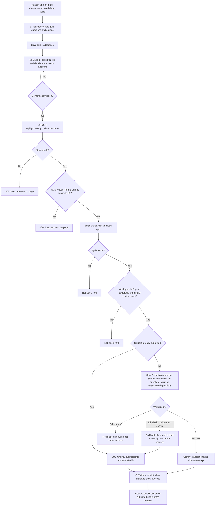

# D：提交保存与 workflow

D 已实现 `POST /api/quizzes/:quizId/submissions`，使用既有 schema 和共享契约，无需新增 migration。C 已有的提交确认、共享回执校验、成功页及草稿清理直接使用这个接口。

## 流程图

可直接打开或用于展示的图片：[workflow.svg](workflow.svg)。以下为可维护的 Mermaid 源码，展示 A/B/C/D 的完整业务链。



## 保存和重复提交规则

- 身份来自固定演示学生，忽略客户端伪造的 `studentId`。
- 请求格式及题目/选项归属、单选限制均在查找已有提交之前检查。非法重试仍返回 400。
- 每道题都有一条答案；省略题目或空选项表示未答，不自动评分。
- 提交记录、答案及选项关联在同一事务内写入；失败全部回滚。
- 第一次提交返回 201；重复提交返回 200 原回执，原答案和提交时间不变。
- 并发冲突仅识别 `Submission(quizId, studentId)` 唯一约束；回滚后读取原记录。其他唯一约束错误不会被当作成功。
- C 收到合法回执后才显示成功；刷新后通过现有列表/详情接口读取数据库中的 `submittedAt`。

## 自动验证

```bash
npm test
npm run build
```

本次验证：162 项测试通过，其中 30 项为新增的提交接口测试；workspace 类型检查和前端生产构建通过。API 单元测试使用 Prisma mock，不能代替实际入库验收。

2026-11-04 已连接真实 PostgreSQL 运行 `npm run test:submissions:db` 并通过：B 创建 → C 读取 → D 保存、空答案、非法答案不落库、重复提交不覆盖、8 个并发请求只产生一份提交，以及列表/详情的已提交状态。用户也已手动确认页面、三条答案记录及所选选项均正常。

在已初始化数据库的环境可直接重跑验收；首次运行在根目录依次执行：

```bash
docker compose up -d --wait
npx prisma migrate dev
npx prisma db seed
npm run test:submissions:db
```

数据库验收脚本通过真实 B/C/D 路由创建临时测验并核对数据库：非法答案不落库、多选答案和漏答保存、全空提交、重复提交不覆盖、8 个并发请求只产生一份提交，以及列表/详情的已提交状态。脚本结束后清理本次临时测验和提交，不修改 seed 测验及已有用户提交。无需另行启动 API 服务。

## 页面演示验收

1. `npm run dev` 后访问 `/teacher`，创建一个新测验（建议包含单选和多选）。
2. 在 `/student` 找到它，进入详情；作答一部分题目，保留一道未答。
3. 点击提交，检查确认框的已答/未答数量，再确认提交。
4. 页面应显示成功、提交 ID 和时间；刷新仍显示已提交，列表也应更新。
5. `npx prisma studio --port 5555` 查看 `Submission`、`SubmissionAnswer` 及选项关联：提交属于 `student-demo`，每题一条答案，未答题无选项关联。

每个演示学生对一个测验只保存一次答案。需要重复演示时新建测验即可。
